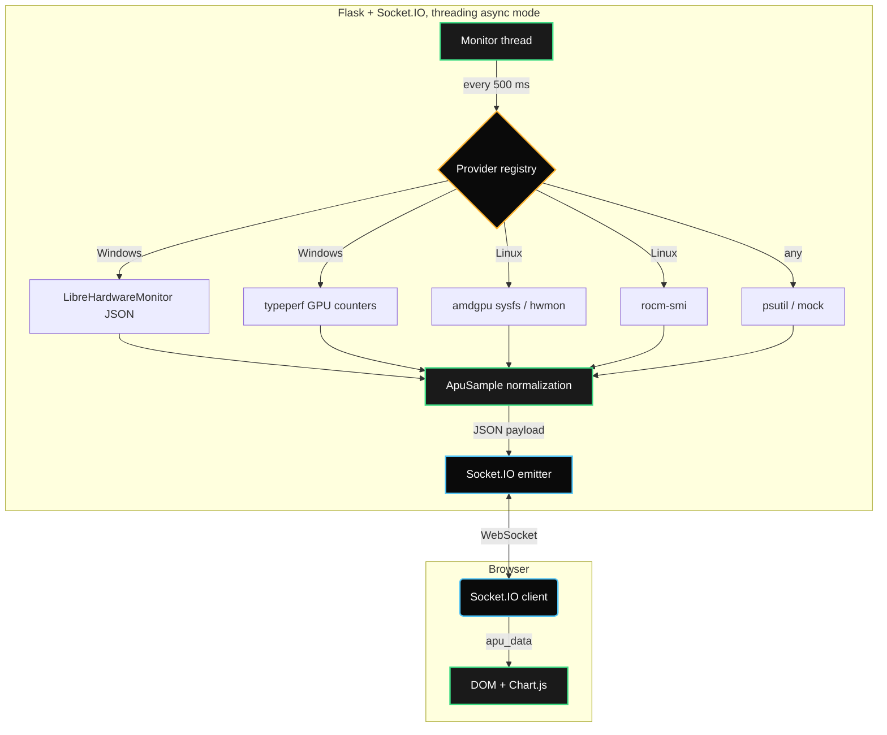

<div align="center">

# APU-Power-Monitor

**Real-time power, utilization and memory telemetry for integrated graphics**

[](https://opensource.org/licenses/MIT)
[](https://www.python.org/)
[](https://flask.palletsprojects.com/)
[](https://socket.io/)

*A sub-second web dashboard for AMD and Intel APUs, streaming SoC power, GPU load and shared-memory usage over WebSockets.*

</div>

---

## Why this is not just "the NVIDIA one with a different command"

A discrete GPU has `nvidia-smi`: one binary, one CSV line, every metric. An APU
has nothing of the sort, and the reason is architectural rather than cosmetic.

| | Discrete GPU | APU (integrated) |
|---|---|---|
| Power rail | Board power, reported by the card | One SoC package rail shared by CPU and iGPU |
| Power ceiling | TGP, published and readable | PPT/TDP, negotiated at runtime, usually unreadable from userspace |
| Memory | Dedicated VRAM, exact | A carve-out plus a shared system-RAM pool |
| Access | Vendor CLI, any user | Kernel driver (Windows) or sysfs (Linux) |

So this project does not wrap a command. It defines one normalized metric
schema and puts several **providers** behind it, picking the best one available
on the machine it starts on. Metrics are nullable by design: `null` means "this
machine cannot report it", which the dashboard renders as an explicit
*unavailable* state rather than as a misleading `0`.

## Dashboard

- **Package power** with the configured limit drawn as a dashed line, plus a running peak.
- **GPU memory** against the shared-memory budget.
- Summary strip: device, temperature, GPU load, CPU load, power, memory.
- Provider chip and notes explaining exactly where each number comes from.
- Panels that grey out with a reason when the active provider has no such sensor.

## Architecture



**Async model.** Socket.IO runs in `threading` mode, so sampling happens on a
real OS thread. A hardware read that blocks for 200 ms cannot stall the server
loop, and no `eventlet`/`gevent` monkey-patching is required. The sampling
thread starts at import time, not inside `__main__`, so the stream also works
behind a production WSGI server.

## Providers

Detection runs highest priority first and takes the first provider that reports
itself available.

| Provider | Platform | Power | Temp | GPU load | Memory | Notes |
|---|---|:-:|:-:|:-:|:-:|---|
| `lhm` | Windows | yes | yes | yes | yes | Needs LibreHardwareMonitor running with its web server on |
| `amd-sysfs` | Linux | yes | yes | yes | yes | `amdgpu` driver, no root needed, cheapest path |
| `windows-perf` | Windows | – | – | yes | yes | PDH counters via one long-lived `typeperf`; no driver needed |
| `rocm-smi` | Linux | yes | yes | yes | yes | Only if ROCm is installed |
| `psutil` | any | – | maybe | – | – | Last resort: CPU load and system RAM only |
| `mock` | any | yes | yes | yes | yes | Synthetic data for UI work |

### Getting power and temperature on Windows

Windows exposes GPU utilization and memory as performance counters, but SoC
power and die temperature sit behind the SMU and need a kernel driver. Rather
than ship one, this project reads
[LibreHardwareMonitor](https://github.com/LibreHardwareMonitor/LibreHardwareMonitor),
which already has it:

1. Run LibreHardwareMonitor (as administrator, so the sensors populate).
2. **Options → Remote Web Server → Run**, port `8085`.
3. Start this app. The `lhm` provider is picked automatically.

Without it you still get GPU load and shared-memory usage from `windows-perf`,
and the power panel says plainly that it has no sensor.

## Installation

```bash
git clone https://github.com/AdityaGuhaa/APU-Power-Monitor.git
cd APU-Power-Monitor
python -m venv .venv
```

```powershell
# Windows
.venv\Scripts\activate
```

```bash
# Linux / macOS
source .venv/bin/activate
```

```bash
pip install -r requirements.txt
python app.py
```

The dashboard is at <http://127.0.0.1:5000>. It binds to loopback by default:
this is hardware telemetry, so it is not published to the LAN unless you ask.

### Developer mock mode

```powershell
$env:APU_MONITOR_MOCK="1"; python app.py
```

```bash
APU_MONITOR_MOCK=1 python app.py
```

## Configuration

Everything is environment variables, read once at startup.

| Variable | Default | Meaning |
|---|---|---|
| `APU_MONITOR_HOST` | `127.0.0.1` | Bind address. Use `0.0.0.0` to expose on the LAN. |
| `APU_MONITOR_PORT` | `5000` | Port. |
| `APU_MONITOR_INTERVAL_MS` | `500` | Sampling cadence. |
| `APU_MONITOR_HISTORY_SECONDS` | `60` | Width of the rolling window. |
| `APU_MONITOR_PROVIDER` | `auto` | Pin a provider by name instead of detecting. |
| `APU_MONITOR_MOCK` | `0` | `1` for synthetic data. |
| `APU_MONITOR_LHM_URL` | `http://127.0.0.1:8085/data.json` | LibreHardwareMonitor endpoint. |
| `APU_POWER_LIMIT_W` | unset | Sustained power limit (PPT), drawn as the limit line. |
| `APU_POWER_MAX_LIMIT_W` | unset | Boost ceiling; locks the power axis. |
| `APU_MONITOR_IDLE_WHEN_IDLE` | `1` | Stop polling hardware when no browser is connected. |
| `APU_MONITOR_CORS_ORIGINS` | same-origin | Comma-separated origins, or `*`. |
| `APU_MONITOR_SECRET_KEY` | random | Only needed behind a multi-worker proxy. |

Because an APU rarely reports its own power envelope, `APU_POWER_LIMIT_W` is
how the limit line gets drawn. Leave it unset and the power axis auto-scales to
the highest value seen so far instead.

## API

### WebSocket events (server → client)

`apu_meta` — sent once per connection:

```json
{
  "provider": "lhm",
  "provider_description": "LibreHardwareMonitor remote web server",
  "interval_ms": 500,
  "power_limit": 45.0,
  "power_max_limit": 54.0,
  "samples_taken": 1024
}
```

`apu_data` — every interval, and once immediately on connect (last known
sample, so the dashboard is never blank):

```json
{
  "timestamp": 1795188351999.7,
  "interval_ms": 500,
  "provider": "lhm",
  "devices": [
    {
      "source": "lhm",
      "device_name": "AMD Radeon 780M Graphics",
      "power_draw": 12.79,
      "power_limit": 45.0,
      "power_max_limit": 54.0,
      "gpu_utilization": 14.1,
      "cpu_utilization": 13.7,
      "temperature": 46.2,
      "memory_used": 2777.7,
      "memory_total": 8192.0,
      "available": ["power_draw", "power_limit", "gpu_utilization"],
      "notes": ["power is the whole SoC package (CPU + iGPU)"]
    }
  ]
}
```

Units: watts, percent, degrees Celsius, MiB. Any field may be `null`;
`available` lists the ones that are not.

`apu_error` — the provider returned nothing:

```json
{ "message": "No data from provider 'lhm'.", "consecutive_failures": 3 }
```

### HTTP

| Route | Purpose |
|---|---|
| `GET /` | The dashboard. |
| `GET /api/meta` | Provider, cadence, window, configured power envelope. |
| `GET /api/snapshot` | One reading as JSON, for scripts and health checks. `503` when no data. |

## Project layout

```text
APU-Power-Monitor/
├── app.py                        # Flask + Socket.IO server, routes, events
├── config.py                     # Every setting, read once from the environment
├── requirements.txt
├── apumon/
│   ├── metrics.py                # ApuSample schema + sensor-value sanitizing
│   ├── monitor.py                # Sampling loop, idling, failure reporting
│   └── providers/
│       ├── base.py               # Provider interface
│       ├── lhm.py                # LibreHardwareMonitor (Windows)
│       ├── windows_perf.py       # typeperf PDH counters (Windows)
│       ├── amd_sysfs.py          # amdgpu sysfs / hwmon (Linux)
│       ├── rocm_smi.py           # rocm-smi JSON (Linux)
│       ├── psutil_basic.py       # CPU + RAM fallback (any)
│       └── mock.py               # Synthetic data (any)
├── static/{css,js,img}/          # Pitch-black theme, Chart.js client, logo
├── templates/index.html
└── tests/                        # 30 unit tests, stdlib unittest
```

## Development

```bash
python -m unittest discover -s tests -t .
```

The suite covers value sanitizing, the nullable schema, provider selection, the
LibreHardwareMonitor tree walker, and the sampling loop (idling, failure
reporting, limit fallback) against a fake Socket.IO. No hardware required.

Adding a provider: subclass `SensorProvider`, implement `is_available()` and
`read()`, and add it to `build_providers()` with a priority. Nothing else
changes — the schema, the UI and the API already handle partial data.

### Planned

- Intel SoC power via RAPL (`/sys/class/powercap` on Linux; needs a driver on Windows).
- Per-process GPU attribution from the PDH instance names already being parsed.
- Optional on-disk history so a reconnect does not start from an empty chart.

## Requirements

* **OS**: Windows 10/11, or Linux with the `amdgpu` driver. macOS runs in mock mode.
* **Python**: 3.9+
* **Hardware**: any AMD or Intel integrated GPU. Discrete GPUs are shown too, but [NVIDIA-GPU-PowerMonitor](https://github.com/AdityaGuhaa/NVIDIA-GPU-PowerMonitor) reports far more for NVIDIA cards.

## License

MIT. Copyright (c) 2026 Aditya Guha. See [LICENSE](LICENSE).
